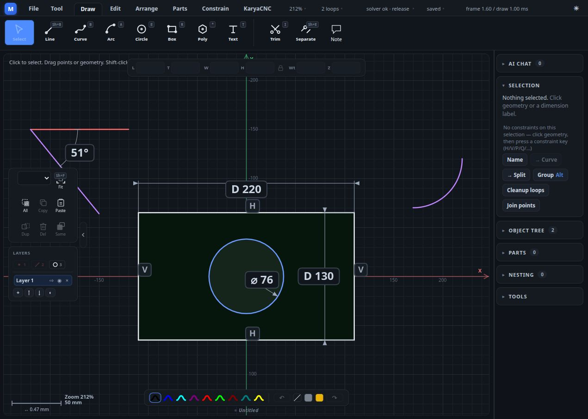
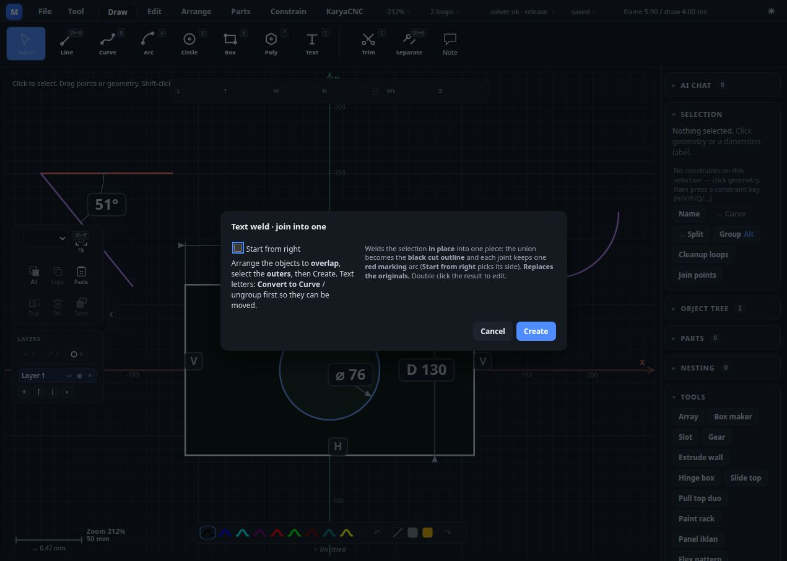
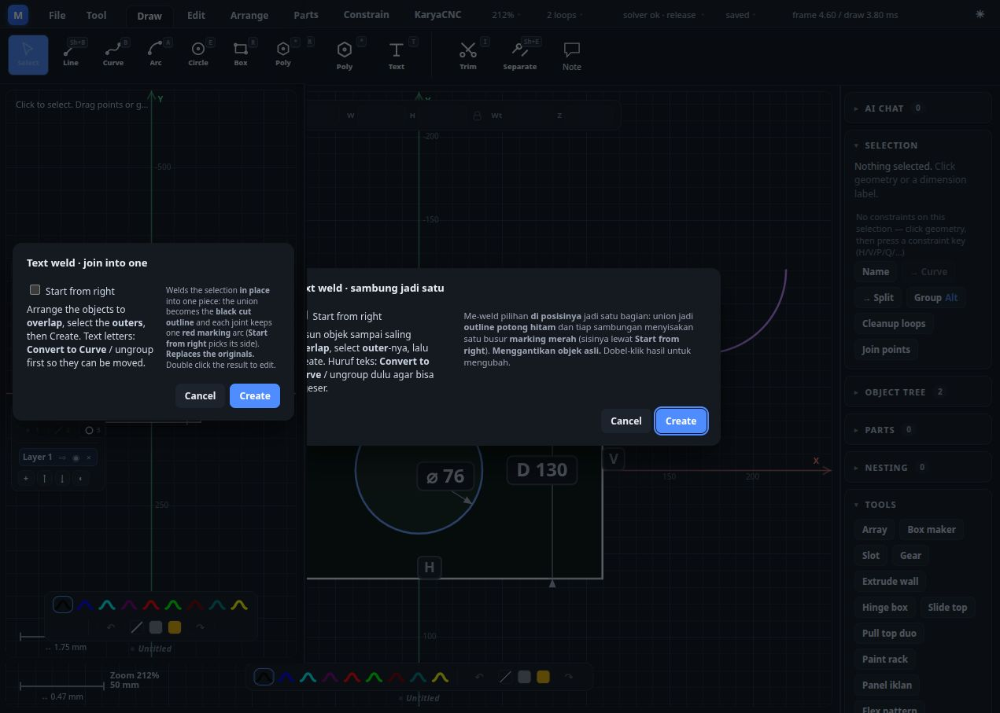
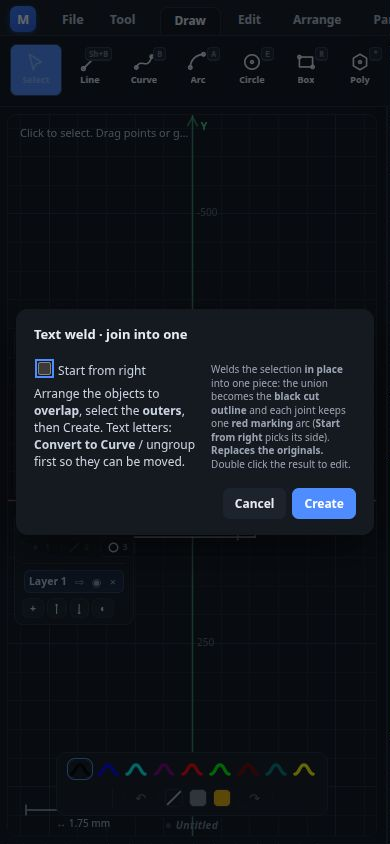

# MiniSketch

A keyboard-driven **2D constraint sketcher that speaks CNC**: draw with real
dimensions in your browser, generate laser / router-ready parts with one-click
tools, nest them, and send the job to the machine — no install, no build step.



The sketch above is a live drawing: `D 220`, `D 130` and `Ø 76` are **driving
dimensions** and the `H`/`V` badges are constraints. Edit a number and the
geometry solves; drag a corner and everything that depends on it follows.

## Why you might like it

- **A real constraint solver, not just a canvas.** Coincidence, horizontal /
  vertical, midpoint / on-line, perpendicular, parallel, angle and aspect
  constraints; three solve modes (on release, live while dragging, manual
  `F9`). Dimension labels are draggable and editable in place.
- **Exact booleans on true Béziers.** Union / intersect / subtract run on the
  real cubic geometry, so curves stay curves — no polygon faceting, no lost
  resolution. Text weld uses it to join overlapping letters into *one*
  connected cut piece, leaving a single red **marking** arc per joint.
- **Generator tools for the parts CNC people actually cut.** Thirteen
  parametric builders (box, gears, finger joints, living hinges, spirals,
  slots…). Every result is a group: **double click it to reopen the dialog
  with its parameters** and rebuild in place. Finger joints stay *modifiers
  of your master line* — move the line, the row follows and re-derives.
- **Nesting and image tracing built in.** A local GA + NFP nest engine (a
  trimmed port of KaryaCNC's nestjs2) and a raster→curve tracer with
  re-openable settings.
- **Two languages, one switch.** File → **Lang: English / Indonesia** re-writes
  every tool window's guide text (and the built-in Help) — parameter names
  stay canonical English, the explanations speak your language.
- **Made for the workshop, not just the desk.** Run one command and open the
  same app from your phone over Wi-Fi — dialogs reflow to a phone-sized
  two-column layout, autosave included.
- **Local-first and private.** Documents autosave to the browser (with
  crash-recovery from a `.bak`), save as readable JSON (`.sketch`), export SVG,
  and `Ctrl+Shift+C` copies the selection to the OS clipboard as SVG for
  Inkscape / Illustrator. The optional AI chat is **bring-your-own-key**: no
  API key ships in the repo, and the bridge never stores yours.
- **Zero build.** Plain `<script>` tags, static files, works straight from
  disk via `file://`. Clone it, open it, draw.

## A closer look

Every generator lives in the **Tools** panel; dialogs keep parameters on the
left and a short guide on the right:



Guides switch between English and Bahasa Indonesia from File → Lang:



The same app on a phone-sized screen — the guide reflows into a second column
instead of pushing the form off-screen:



## The generator tools

| Tool | What it builds |
| --- | --- |
| **Box maker** | Finger-jointed box laid out flat, inside/outside sizing, optional lid |
| **Gear maker** | Spur gears, racks and pulleys from flat stock (module, teeth, pressure angle, flanges, set screws) |
| **Finger joint** | Puts a tab row on lines you already drew; the line stays the master and drives the joint |
| **Hinge box** | Six panels whose corners are living knuckle hinges instead of finger joints |
| **Slide top** | Box with a lid sliding in rail grooves; red lines mark the glue spots |
| **Pull top duo** | Two sliding tops you pull apart, with clips and finger handles |
| **Extrude wall** | Stands a closed loop up as a flat-pack set with a bendable wall strip and living hinge |
| **Paint rack** | Storage rack: fingered side walls and drilled shelves per tier |
| **Panel iklan** | Sign panel with rounded corners and pen holes in the corners or mid-side |
| **Flex pattern** | Living-hinge strips — interlocked columns that bend both ways, or a single comb |
| **Spiral** | Archimedean spiral from inner to outer diameter, multi-start, gap exactly = pitch |
| **Slot** | Turns any path into a slot outline (round ends); a closed path becomes a groove |
| **Text weld** | Welds overlapping letters / objects into one connected cut piece with red marking arcs |

Plus **Array**, **Nesting** (GA + NFP, runs locally in a worker), **Image
trace** (re-openable, keeps its frame constraints) and a machine-side **cost
estimate**. Red `#ff0000` geometry is always a *marking* pass — it engraves,
it doesn't cut.

## Quick start

Any modern desktop browser. Millimetres, Y up.

```bash
git clone https://github.com/ryannining/minisketch.git
cd minisketch

# Option A — no tools at all: open index.html straight from disk (file://)
#
# Option B — one small server: phone access, AI chat, no-cache reloads
node server/serve.js            # http://localhost:8090
```

Then: draw with `Shift+B` (line) / `B` (curve) / `R` (box) / `E` (circle) /
`T` (text), constrain with the keys shown in the ribbon, press `?` for the
built-in bilingual Help.

### From your phone

```bash
node server/serve.js            # binds 0.0.0.0 — the LAN, not just localhost
# open http://<this-pc-ip>:8090/ on the phone
```

### AI chat (optional, bring your own key)

Fill **Settings › AI chat** (API base URL, key, model). The key travels with
each request to the small bridge in `server/` and is never persisted in the
repo; with no key the bridge answers 400 and names the setting to fill. CORS
is an allowlist (local file, localhost, LAN) so a random web page can't spend
your key.

## Sending to the machine

The **KaryaCNC** tab carries the machine dialog: colour is interpreted as the
process (black = cut, red = marking, green = construction layer), the nesting
engine shares its lineage with KaryaCNC's, and **Send to KaryaCNC** (`Alt+Q`)
hands the job to the machine controller.

## Documentation in the repo

| File | What's inside |
| --- | --- |
| [`ARCHITECTURE.md`](ARCHITECTURE.md) | Data model, invariants, where each kind of change belongs |
| [`createtools.md`](createtools.md) | Handbook for writing a generator tool: the full `api` contract and conventions |
| `help.js` | The in-app Help content, English and Indonesian side by side |
| [`agents.md`](agents.md) | The rules every contributor-agent works under (testing policy) |

## Testing

Core maths and the tool contract are covered by DOM-free Node probes:

```bash
node tests/smoke.js               # core.js regression suite
node testing/tools_probe.js       # every registered tool against the contract (115 checks)
node testing/assembly_probe.js    # constraint-solver assembly cases
node --check app.js               # syntax gate for edited files
```

Visual behaviour is verified by hand in the browser — the probes prove the
logic, a human proves the pixels.

## Project layout

```
index.html      layout, menus, dialogs
styles.css      all styling
core.js         pure math (solver, splines, booleans helpers) — also a Node module
app.js          the application: state, rendering, tools, solver wiring, import/export
tools/          registry + one file per generator + nest/trace engines + vendored libs
fonts/          generated single-line & outline fonts (Hershey + TTF via FontFace)
help.js         bilingual Help content
server/         dev static server + the AI bridge (BYOK)
testing/        DOM-free Node probes per feature
tests/          core.js smoke tests
ai/             in-browser AI chat panel
```
