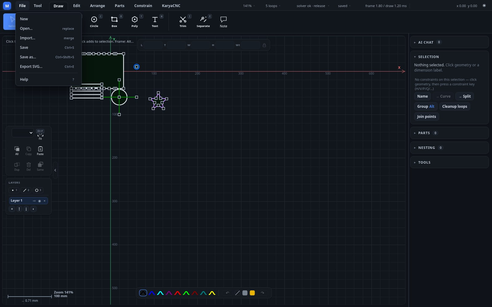
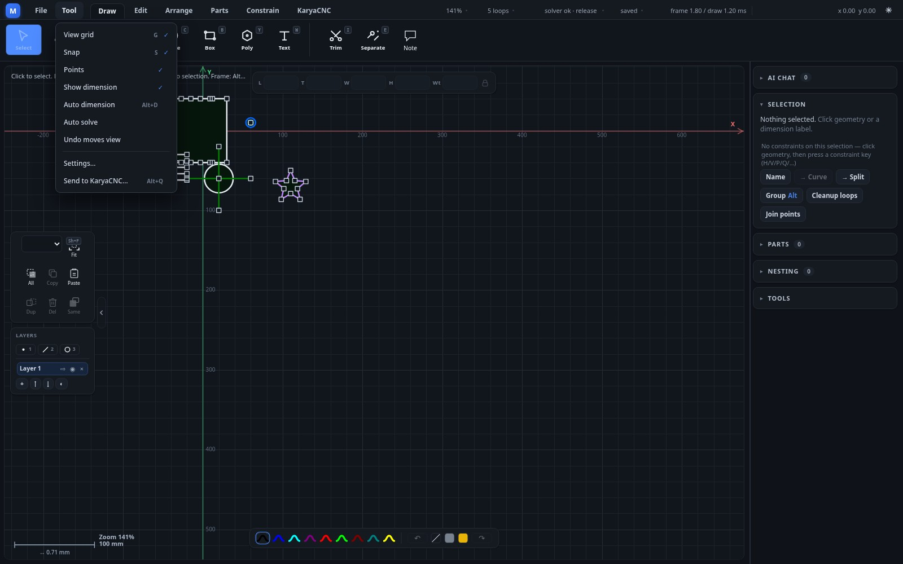
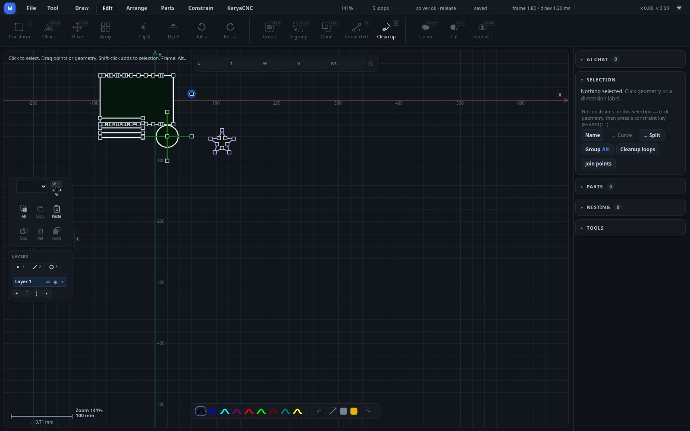
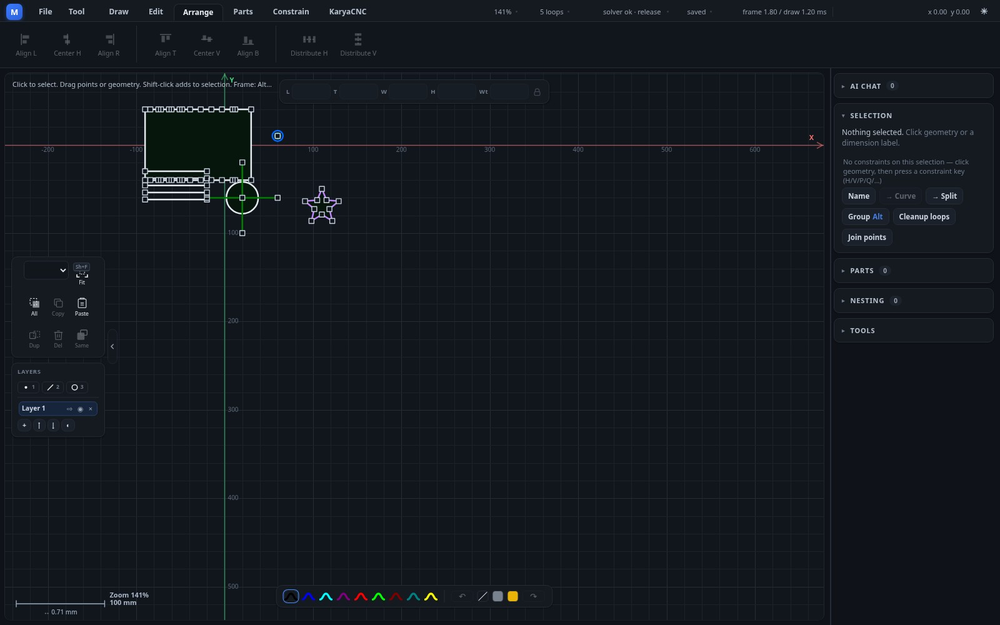
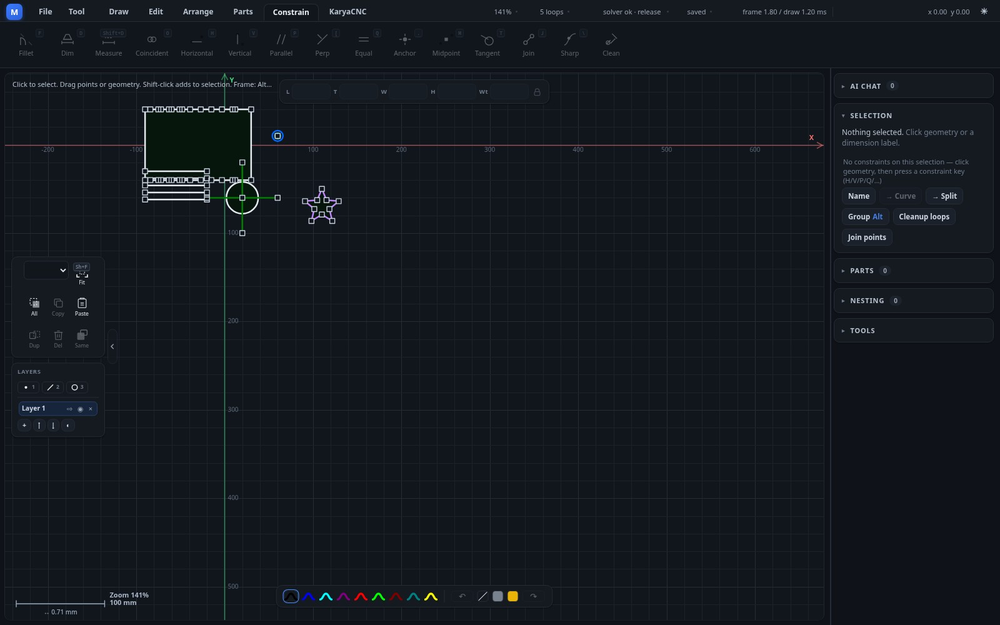
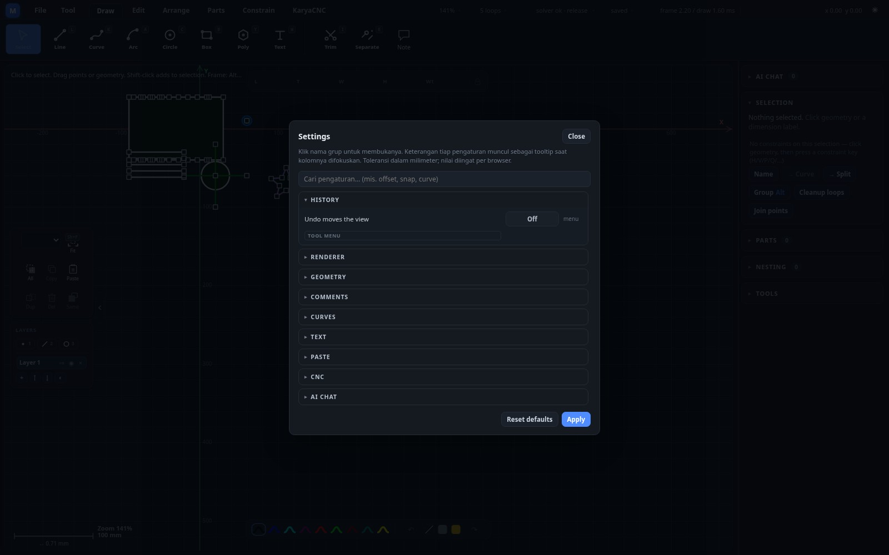
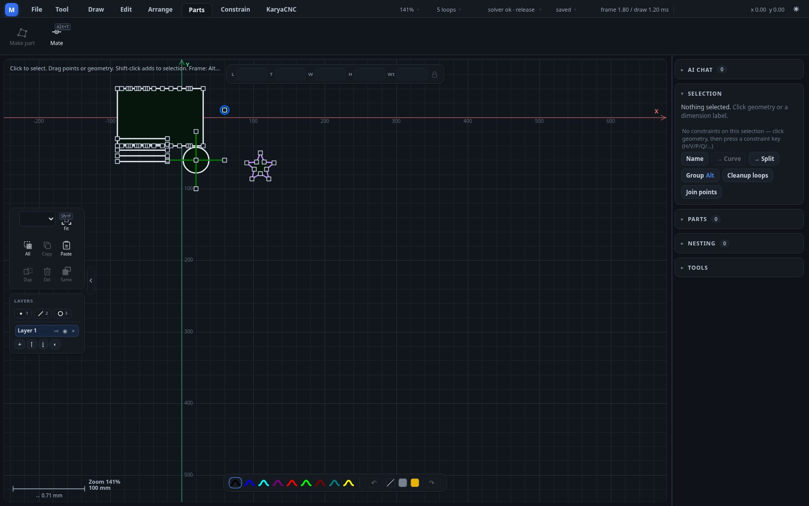
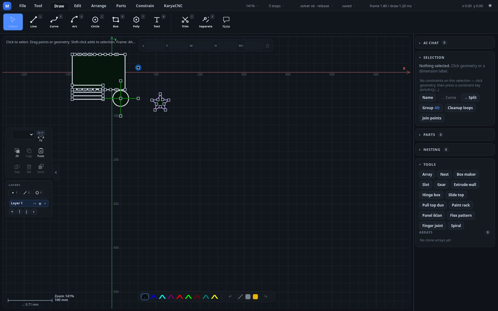
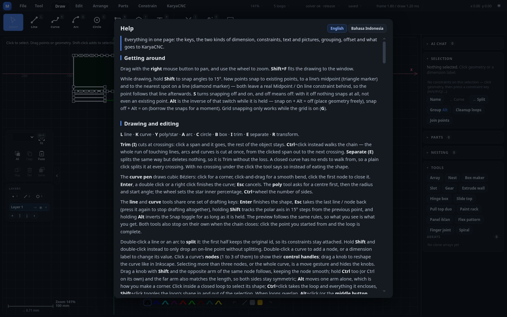
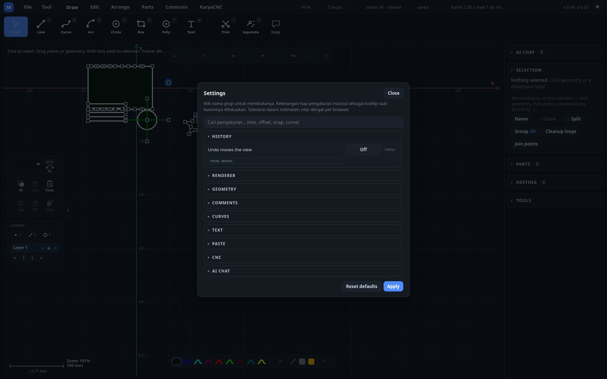

# Panduan Lengkap Menggunakan MiniSketch

Versi: MiniSketch 2D constraint sketcher (browser app)
Bahasa: Indonesia

MiniSketch adalah aplikasi sketsa 2D berbasis batasan (constraint sketcher) yang berjalan di browser. Cocok untuk menggambar potongan CNC, memberi dimensi penggerak, dan mengirim hasil ke KaryaCNC.

Semua screenshot diambil langsung dari aplikasi dan disimpan di folder `screenshots/`.

---

## 1. Memulai

Buka `index.html` di browser (disarankan melalui HTTP, bukan `file://`, misalnya `python3 -m http.server` lalu buka `http://localhost:8090/index.html`).

Aplikasi langsung membuka lembar gambar kosong dengan tema gelap.

### Langkah cepat pertama
1. Tekan **L** untuk alat Garis, atau klik tombol Garis di ribbon Draw.
2. Klik titik awal di kanvas, lalu klik titik akhir. Klik lagi untuk rangkaian garis berturut-turut.
3. Tekan **Enter** untuk menyelesaikan, atau **Esc** untuk batalkan.
4. Tekan **F9** untuk menyelesaikan (solve) sketsa.

---

## 2. Tampilan Utama

Layar terbagi menjadi:

- **Ribbon atas** — menu File dan Tool, serta tab kerja (Draw, Edit, Arrange, Constrain, KaryaCNC, Parts).
- **Kanvas besar** — tempat menggambar. Skala dasar di pojok kiri bawah.
- **Panel kanan (sidebar)** — AI Chat, Selection, Parts, Nesting, Tools.
- **Strip L/T/W/H** — di atas kanvas, mengatur batas objek yang dipilih langsung.

Contoh sketsa yang sudah selesai (kotak dengan tab finger joint, lingkaran, garis konstruksi, bintang):

---

## 3. Menu Berkas

Buka dengan tombol **File** di ribbon atau tombol pintas.

- **Ctrl+O** — Open (mengganti seluruh sketsa dengan file `.sketch` / `.json`)
- **Ctrl+I** — Import (menggabungkan file ke sketsa yang aktif: SVG, PDF, CDR, DXF ASCII)
- **Ctrl+S** — Simpan (dialog Save dengan nama terakhir; menulis ulang file yang sedang dibuka)
- **Ctrl+Shift+S** — Save as… (selalu menanyakan nama file lagi)
- **Ctrl+E** — Ekspor SVG

Nama file yang sedang dibuka tampil sebagai keterangan kecil di bawah panel warna (dan di judul tab browser bila ada). Titik kecil di sebelahnya menyala saat dokumen berbeda dari file di disk. Klik keterangan itu = Save.

---

## 4. Menu Alat (Tool)

Menu Tool berisi opsi tampilan dan operasi mesin:

- View Grid (**G**)
- Snap (**S**)
- Points (tampilkan marker titik)
- Show dimension
- Auto dimension (**Alt+D**)
- Settings
- Send to KaryaCNC (**Alt+Q**)

---

## 5. Tab Draw — Menggambar

Alat gambar tersedia sebagai tombol besar di ribbon Draw dan via tombol pintas huruf:

| Tombol | Alat | Keterangan |
|---|---|---|
| **L** | Garis | Klik titik awal, titik akhir, dan seterusnya |
| **K** | Kurva Bézier | Klik sudut, klik-tahan-geser untuk lengkung |
| **Y** | Poligon / Bintang | Titik pusat, lalu radius dan sudut awal |
| **A** | Busur | 3 titik (awal, tengah, akhir) |
| **C** | Lingkaran | Titik pusat lalu radius |
| **B** | Kotak | Drag untuk menentukan ukuran |
| **W** | Teks | Isi konten, pilih font dan gaya |
| **I** | Potong | Potong di persimpangan |
| **E** | Pisah | Membelah tanpa menghapus |
| **R** | Transformasi | Pindahkan, putar, ubah ukuran objek |

### Tips saat menggambar
- **Shift** saat menggambar: sudut menempel ke kelipatan 15°.
- **Alt** saat menggambar: membalik status Snap sementara.
- **Enter**: selesaikan bentuk. **Esc**: batalkan atau ambil garis/node terakhir kembali.
- Klik titik awal lagi untuk menutup lingkaran (loop lengkap).

---

## 6. Tab Edit — Mengubah Objek

Operasi utama di Edit:

| Pintas | Fungsi |
|---|---|
| **Ctrl+A** | Pilih semua |
| **Ctrl+C / Ctrl+V** | Salin / Tempel |
| **Ctrl+D** | Duplikat di tempat yang sama |
| **Ctrl+K** | Pasang kurva melalui polyline (dialog Tolerance + Sharp corner) |
| **Del** | Hapus pilihan |
| **Ctrl+Z / Ctrl+Shift+Z** | Batalkan / Ulangi |
| **Ctrl+G** | Bungkus pilihan menjadi satu objek |
| **Ctrl+U** | Bongkar group |
| **Ctrl+J** | Offset (preview putus-putus, roda mouse ubah jarak) |
| **Ctrl+M** | Geser objek (pilih titik referensi, lalu tujuan) |
| **Ctrl++ / Ctrl+- / Ctrl+0** | Boolean union / cut / intersect pada loop |
| **J** | Sambung titik yang bersentuhan |
| **F** | Buat fillet pada sudut |
| **Z** | Bersihkan seleksi menjadi loop utuh |

---

## 7. Tab Arrange — Susun Objek

Digunakan untuk mengatur posisi dan relasi antar objek di kanvas.

---

## 8. Tab Constrain — Batasan

Pilih geometri atau titik, lalu tekan tombol pintas constraint:

| Pintas | Constraint |
|---|---|
| **T** | Menyinggung (tangent) |
| **O** | Berimpit / coincidant |
| **H** | Horizontal |
| **V** | Vertikal |
| **P** | Sejajar (parallel) |
| **[** | Tegak lurus (perpendicular) |
| **Q** | Sama panjang (equal) |
| **.** | Jangkar (anchor) |
| **M** | Titik tengah (midpoint) |
| **F** | Fillet |
| **Alt+T** | Mate part (perakitan) |

Tekan tombol yang sama lagi untuk menghapus constraint tersebut dari pilihan. Sebelum constraint dipasang, sketsa diperiksa: duplikasi atau konstrikasi ditolak dengan alasan.

---

## 9. Tab KaryaCNC

Digunakan untuk mengirim sketsa ke mesin KaryaCNC melalui dialog **Tool ▸ Send to KaryaCNC**.

Pengaturan dialog:
- **Host dan port** — default port 8887 (rentang 8885–8889)
- **Objek yang dikirim** — terpilih, terlihat, atau hanya layer aktif
- **Toleransi flatten** dan **chaining**
- **Route** — Classic (teks WebSocket, default) atau JSON (v1 wire contract, `skipJoin:true`)

Aldelan warna adalah kode operasi KaryaCNC: hitam potong, biru engrave, cyan v-carve, ungu pocket, merah gores, hijau mark, maroon cut tab, teal titik awal.

Loop fill: klik di dalam loop tertutup, pilih **None**, **Gray**, atau **Yellow**.  
Sort weight (kolom Wt di strip L/T/W/H): menentukan urutan pemotongan (-100 sampai 100).
Depth override (kolom Z setelah Wt): kedalaman mesin dalam mm untuk objek terpilih (harus > 0), dikirim sebagai `p.depth`; KaryaCNC memakainya untuk potong/engrave/mark/pocket, bukan kedalaman bawaan carved/zdown. Kosong atau 0 = pakai bawaan mesin. Objek dengan depth ditandai badge **Z** beserta nilainya (mis. `Z 2.5`).

---

## 10. Tab Parts — Part dan Assembly

- **Make part**: ubah pilihan menjadi satu benda kaku (polyline per kontur, marker di setiap node dan tengah segmen, marker pusat untuk loop tertutup).
- Garis bantu (hijau) tidak ikut di-bake.
- Part hanya bisa berputar dan bergeser; menggeser satu titik memindahkan seluruh part.
- **Mate (Alt+T)**: gabungkan dua part — marker→marker = pin (biru), marker→garis = slider (ungu), klik marker sama dua kali = weld (merah), centang **ground** = paku marker ke dunia.

---

## 11. Panel Sidebar

Panel di kanan berisi:
- **AI Chat** — perintah AI (jika diatur di Settings)
- **Selection** — daftar objek dan constraint yang dipilih
- **Parts** — daftar part yang telah dibuat
- **Nesting** — susun loop tertutup ke atas lembar (genetic algorithm, seluruhnya di browser)
- **Tools** — generator kotak (Box maker, Gear maker, Hinge box, Extrude wall, Slide top)

---

## 12. Jendela Help

Buka kapan saja dengan tombol **?** atau **Shift+Z**. Tutup dengan **Esc** atau Close.

Help menampilkan dokumentasi lengkap berdua bahasa (English dan Indonesian) di sebelahnya.

---

## 13. Pengaturan dan Tema

Buka melalui **Tool ▸ Settings**. Berisi semua toleransi dan kerapatan di satu tempat:
- Toleransi chaining, detail objek
- Sudut dan detail offset
- Segmen kurva, segmen busur, panjang tali lingkaran
- Detail dan ukuran raster teks
- Ukuran maksimum gambar hasil paste
- Toleransi flatten CNC

Nilai kecil = outline lebih rapat dengan lebih banyak titik. Nilai besar = lebih sedikit titik, hasil lebih kasar. Tekan **Apply** untuk menyimpan; diingat per browser.

Tombol ☀ / 🌙 di pojok atas beralih tema terang/gelap. Kode warna di dalam file tidak berubah, hanya diterangkan di layar saat tema gelap.

---

## 14. Mengirim ke KaryaCNC

1. Siapkan sketsa dan pastikan semua dimensi penggerak terpenuhi (dimensi yang belum terpenuhi digambar warna amber).
2. Buka **Tool ▸ Send to KaryaCNC** atau tekan **Alt+Q**.
3. Atur host, port, objek yang akan dikirim, dan route.
4. Klik kirim. Aplikasi menunggu balasan `ACK` dari KaryaCNC.

Catatan: teks dan objek hasil paste di-trace saat dikirim, atau tekan **→ Curve** terlebih dahulu. SVG export bisa hanya pilihan, hanya layer terlihat, atau hanya layer aktif, dengan garis hairline untuk Inkscape.

---

## 15. Pintas Keyboard Lengkap

**Berkas**
- Ctrl+O — Open (ganti)
- Ctrl+I — Import (gabung)
- Ctrl+S — Simpan ke browser
- Ctrl+Shift+S — Unduh .sketch
- Ctrl+E — Ekspor SVG

**Alat**
- L garis · K kurva · Y poligon/bintang · A busur · C lingkaran · B kotak · W teks · I potong · E pisah · R transformasi

**Edit**
- Panah — geser pilihan 1 mm
- ; — komentar · Ctrl+A pilih semua · Ctrl+C salin · Ctrl+D duplikat · Ctrl+K fit kurva · Ctrl+V tempel · Del hapus · Z bersihkan loop · Ctrl+Z batalkan · Ctrl+Shift+Z ulangi · Ctrl+G bungkus · Ctrl+U bongkar · Ctrl+J offset · Ctrl+M geser · Ctrl++ union · Ctrl+- cut · Ctrl+0 intersect

**Constraint**
- D dimensi penggerak · Shift+D ukur (referensi) · T menyinggung · O berimpit · H/V horizontal/vertikal · P sejajar · [ tegak lurus · Q sama panjang · . jangkar · M titik tengah · F fillet · J sambung titik · Alt+T mate part

**Tampilan & Mesin**
- Wheel zoom · Right drag geser · Shift+F pas ke layar · G grid · S snap · Alt+D auto dimension · \ sharp/smooth titik · N pilih yang tersambung · Esc batal · F9 solve sekarang · Alt+Q kirim ke KaryaCNC · ? jendela help

---

## 16. Cara Kerja Umum (Contoh)

1. Buka aplikasi, pastikan klembar kosong.
2. Pilih alat **B** (Kotak), drag di kanvas untuk membuat kotak.
3. Pilih alat **C** (Lingkaran), tambahkan lubang di tengah kotak.
4. Beri constraint **Q** (sama panjang) pada sisi kotak jika ingin persegi.
5. Beri dimensi **D** pada lebar kotak, masukkan nilai (misalnya 100).
6. Tekan **F9** untuk menyelesaikan sketsa.
7. Ubah warna loop sesuai operasi KaryaCNC (hitam = potong).
8. Buka **Tool ▸ Send to KaryaCNC**, atur dan kirim.

---

Selamat menggunakan MiniSketch. Jika ada hasil yang tidak sesuai, periksa console browser dan pastikan solver sudah dijalankan (F9) setelah menggambar.
