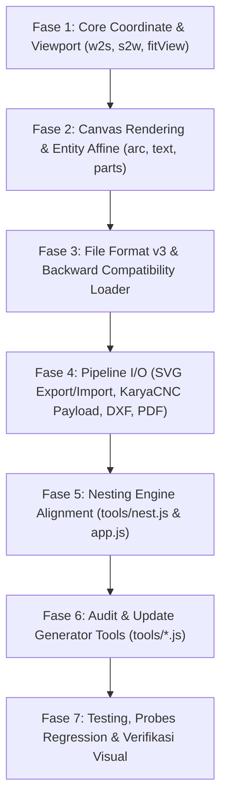

# Analisis & Rencana Perbaikan Sistem Koordinat Sumbu Y (MiniSketch → KaryaCNC Standard)

> **Dokumen Analisis Arsitektur & Rencana Kerja**  
> **File:** `perbaikanY.md`  
> **Target:** Menyelaraskan sistem koordinat MiniSketch dengan ekosistem KaryaCNC (Standar Canvas/SVG: Y ke bawah positif, Y ke atas negatif).

---

## 1. Ringkasan Eksekutif & Akar Masalah (Root Cause)

### 1.1 Masalah Pokok
Di awal pembuatan MiniSketch, sistem koordinat dunia (*world coordinate*) mengadopsi konvensi matematika Cartesius murni:
- **+X mengarah ke kanan**
- **+Y mengarah ke ATAS (positif)** *(bawah negatif)*

Sementara itu, **seluruh aplikasi dalam ekosistem KaryaCNC** (dan standar grafis web modern: HTML5 Canvas, SVG, CSS, Qt/DOM, serta engine nesting referensi `nestjs2` / `nesting2`) menggunakan konvensi Computer Graphics / Screen Coordinates:
- **+X mengarah ke kanan**
- **+Y mengarah ke BAWAH (positif)**
- **Arah ke ATAS adalah Y NEGATIF** *(atau Y mengecil)*

```
 MiniSketch Saat Ini (Cartesian Y-Up)       Ekosistem KaryaCNC / SVG / Canvas (Y-Down)
          +Y (Atas)                                  -Y (Atas)
           ▲                                          ▲
           │                                          │
 ──────────┼──────────► +X                  ──────────┼──────────► +X
           │                                          │
           ▼                                          ▼
          -Y (Bawah)                                 +Y (Bawah)
```

### 1.2 Mengapa Ini Menjadi "Dosa Awal" yang Membuat Pusing?
Perbedaan orientasi ini bukan sekadar perbedaan tampilan visual, melainkan perbedaan topologi dan kalkulasi aljabar yang berdampak ke seluruh sistem:

1. **Implementasi Nesting (NFP & GA):**  
   Engine nesting KaryaCNC (`tools/nest.js`, porting dari `nestjs2`) dirancang untuk koordinat layar (origin kiri-atas, packing tumbuh ke kanan dan ke bawah). Karena MiniSketch Y-up, terjadi anomali pada:
   - Titik awal sheet dan arah penempatan part (harus di-offset `outY = sheetBounds.maxY - blockH`).
   - Matriks varian (rotasi, flip, dan align).
   - Arah winding lubang (*hole winding*) untuk Clipper: Clipper mensyaratkan arah putaran lubang berlawanan dengan outline luar. Membalik Y membalikkan arah putaran (CW ↔ CCW), sehingga offset Clipper sering keliru menggabungkan lubang ke outline luar.
2. **Tools Generator (`tools/*.js`):**  
   Setiap kali ada tool dari project KaryaCNC lain yang di-porting ke MiniSketch (seperti nesting, box maker, panel iklan, dll.), pembuat kode harus "membalik logika di kepala" atau menambahkan transformasi manual. Hubungan antara "top", "bottom", "lid", "base", dan arah normal tab finger-joint menjadi terbalik.
3. **Pipeline I/O Penuh "Hack" Negasi `-y`:**  
   - Di `exportSVG`: hampir setiap koordinat dinegasikan secara manual: `'M ' + fmt(p.x) + ' ' + fmt(-p.y)`.
   - Di `svgImportParse`: matriks dasar harus mengalikan skala Y dengan minus: `[scale, 0, 0, -scale, ...]`.
   - Di `cncBuildPayload` (protokol KaryaCNC): Y harus dicerminkan via `maxY - p[1]`.
4. **Rendering Canvas Rumit:**  
   Fungsi `ctx.arc(...)` di canvas bawaan browser berputar searah jarum jam (*clockwise*) karena canvas adalah Y-down. Karena MiniSketch Y-up, MiniSketch terpaksa membalik semua sudut dan memaksakan flag `anticlockwise = true`:
   `ctx.arc(cs.x, cs.y, r * view.zoom, -ad.a0, -(ad.a0 + ad.sweep), true)`.

---

## 2. Inventarisasi Lengkap Area Terdampak (Audit & Impact Inventory)

Berikut adalah pemetaan rinci seluruh komponen, fungsi, dan file yang terpengaruh oleh perubahan sumbu Y:

### A. Viewport & Transformasi Layar (`app.js`)

| Fungsi / Variabel | Kondisi Saat Ini (Y-Up) | Rencana Perbaikan (Y-Down / KaryaCNC) | Catatan |
|---|---|---|---|
| `w2s(x, y)` | `{ x: x*zoom + ox, y: -y*zoom + oy }` | `{ x: x*zoom + ox, y: y*zoom + oy }` | Hapus tanda minus `-y`. Transformasi menjadi simetris antara X dan Y. |
| `s2w(x, y)` | `{ x: (x-ox)/zoom, y: -(y-oy)/zoom }` | `{ x: (x-ox)/zoom, y: (y-oy)/zoom }` | Hapus tanda minus. |
| `fitView()` | `view.oy = H/2 + ((minY + maxY)/2)*zoom` | `view.oy = H/2 - ((minY + maxY)/2)*zoom` | Sekarang simetris penuh dengan formula `view.ox`. |
| Wheel Zoom / Pan | Menggunakan `s2w` & `w2s` | Mengikuti pembaruan `s2w`/`w2s` | Otomatis sinkron tanpa kalkulasi tambahan. |

### B. Geometri Dasar, Busur (Arc), dan Sudut (`core.js`, `app.js`)

1. **Arah Putaran Sudut (Angular Direction):**
   - Pada Y-up: Sudut `0` di sumbu +X, sudut `+90°` (+π/2) di sumbu +Y (atas). Putaran sudut positif adalah **Counter-Clockwise (CCW)**.
   - Pada Y-down: Sudut `0` di sumbu +X, sudut `+90°` (+π/2) di sumbu +Y (bawah). Putaran sudut positif adalah **Clockwise (CW)**.
2. **Rendering Busur Canvas (`app.js: drawEntities`, `drawDraftArc`):**
   - Saat ini:
     ```javascript
     ctx.arc(cs.x, cs.y, ad.r * view.zoom, -ad.a0, -(ad.a0 + ad.sweep), true);
     ```
   - Diperbaiki menjadi:
     ```javascript
     ctx.arc(cs.x, cs.y, ad.r * view.zoom, ad.a0, ad.a0 + ad.sweep, false);
     ```
     *Artinya: koordinat layar dan koordinat dunia langsung 1:1 tanpa pembalikan tanda sudut!*
3. **Sampling Busur (`core.js: sampleArc`):**
   - Fungsi `sampleArc(c, r, a0, sweep, reverse)`:
     `x = c.x + cos(a) * r`, `y = c.y + sin(a) * r`.
     Rumus parametrik ini tetap berlaku, namun arah visualnya di layar sekarang searah jarum jam (CW) saat sudut membesar.

### C. Winding Poligon, Signed Area, dan Clipper (`core.js`, `tools/clipper.js`, `app.js`)

1. **Shoelace Formula (Signed Area):**
   - Rumus: $\text{Area} = \frac{1}{2} \sum (x_i y_{i+1} - x_{i+1} y_i)$
   - Pada sistem Y-down, hasil positif dari Shoelace merepresentasikan putaran **Clockwise (CW)** di layar, sedangkan negatif merepresentasikan **Counter-Clockwise (CCW)**.
   - Ini cocok 100% dengan konvensi default ClipperLib di lingkungan screen/canvas:
     - Outer contour = Positive area (CW).
     - Hole contour = Negative area (CCW).
2. **`getLoops()` (`app.js`):**
   - Deteksi siklus loop tertutup dan pemisahan pulau (*islands*) serta lubang (*holes*).
   - Pastikan aturan penentuan lubang (`isHole`) dan pengelompokan compound-loop konsisten dengan orientasi baru.

### D. Constraint Solver (`solveSketch` di `app.js`)

Constraint solver bekerja secara numerik (Levenberg-Marquardt), sebagian besar constraint berbasis skalar jarak:
- `coincident`, `distance`, `radius`, `horizontal`, `vertical`: **Tidak terpengaruh** (invarian terhadap tanda Y).
- `pointDim`: Menggunakan 2D cross product:
  $$\text{signed} = \frac{(p.x - a.x) \cdot dy - (p.y - a.y) \cdot dx}{\text{len}}$$
  Karena tanda $dy$ terbalik pada Y-down, tanda dari `side` (+1 atau -1) akan bertukar antara sisi kanan dan kiri garis. Perlu verifikasi dan penyesuaian tanda `side`.
- `tangent`: Menggunakan cross product serupa ke titik pusat busur/lingkaran. Perlu verifikasi tanda `side`.
- `aspect`: Mengunci rasio lebar terhadap tinggi framed object (`hb * ratio - wa`).

### E. Teks & Framed Objects (`text`, `art`, `image`)

1. **Anchor & Guide Frame:**
   - Framed object didefinisikan oleh 3 titik:
     - `p0`: Sudut kiri-atas (*top-left anchor*)
     - `pw`: Sudut kanan-atas (*width guide vector*)
     - `ph`: Sudut kiri-bawah (*height guide vector*)
   - Saat ini di `toolAddText` (`app.js: 12984`):
     ```javascript
     const phId = privatePoint(+x, +y - thH); // Karena Y ke atas positif, bawah adalah y - thH
     ```
   - Diperbaiki menjadi:
     ```javascript
     const phId = privatePoint(+x, +y + thH); // Pada Y-down, arah ke bawah adalah y + thH
     ```
2. **Rendering Teks di Canvas (`drawTextEntity`):**
   - Saat ini:
     ```javascript
     ctx.transform(gg.A.x * zx, -gg.A.y * zx, gg.B.x * zy, -gg.B.y * zy, 0, 0);
     ```
     *(Tanda minus diperlukan untuk melawan inversi sumbu Y canvas).*
   - Diperbaiki menjadi:
     ```javascript
     ctx.transform(gg.A.x * zx, gg.A.y * zx, gg.B.x * zy, gg.B.y * zy, 0, 0);
     ```
     *(Hapus tanda minus, langsung gunakan vektor frame alami).*
3. **Ekstraksi Kontur Font TTF (`textExactLoopsWorld`):**
   - Format OpenType/TrueType menyimpan koordinat font dengan Y-up (baseline di 0, ascender positif).
   - Pemetaan font unit ke reference pixel (`px`, `py`) dan ke world mm harus disesuaikan agar font tidak terbalik.
4. **Font Hershey (`fonts/hershey.js`):**
   - Data Hershey mentah sudah memiliki baseline di `y=22` dan cap-top di `y=1` (alami Y-down). Dengan beralih ke Y-down, pemetaan Hershey menjadi jauh lebih alami.

### F. Nesting Integration (`tools/nest.js` & `app.js`)

Inilah alasan utama perbaikan ini diajukan. Dengan menyamakan sistem koordinat MiniSketch ke standar KaryaCNC:
1. **Engine `tools/nest.js`:**
   - Tidak lagi memerlukan transformasi buatan atau kebingungan arah vertikal.
   - Sheet didefinisikan secara alami dengan `(minX, minY)` di pojok kiri-atas, memanjang ke `+X` dan `+Y`.
2. **Penempatan Hasil Nesting (`nestApplyResult` di `app.js`):**
   - Saat ini:
     `outY = job.sheetBounds.maxY - blockH;` *(karena Y-up, puncak sheet adalah maxY, dan dasar blok adalah maxY - blockH)*.
   - Diperbaiki menjadi:
     `outY = job.sheetBounds.minY;` *(pada Y-down, puncak sheet adalah minY, dan penempatan blok part dimulai dari minY ke bawah)*.
3. **Transformasi Matriks Varian (`nestPlacementMatrixAt`):**
   - Matriks varian (rotasi, flip, align) yang berasal dari engine nesting referensi KaryaCNC dapat dipakai langsung 1:1 tanpa penyesuaian khusus.

### G. Pipeline Ekspor & Impor File

| Format | Fungsi Terkait | Masalah Saat Ini | Rencana Perbaikan (Y-Down) |
|---|---|---|---|
| **SVG Export** | `exportSVG` (`app.js: 26553`) | Semua koordinat dinegasi: `fmt(-p.y)`. Viewbox: `vy = -b.maxY - pad`. Arc sweep diinversi. | **Bersihkan total:** Viewbox menjadi `b.minY - pad`, koordinat ditulis langsung `fmt(p.y)`. 1:1 dengan format SVG standar dunia. |
| **SVG Import** | `svgImportParse` (`app.js: 764`) | Matriks base membalik Y: `[scale, 0, 0, -scale, ...]`. | Matriks base menjadi skala murni: `[scale, 0, 0, scale, ...]`. Tidak ada pencerminan. |
| **KaryaCNC Protocol** | `cncBuildPayload` (`app.js: 24417`) | Menggunakan hack `maxY - p[1]` untuk membalik Y agar sesuai controller KaryaCNC. | Hilangkan hack! Gunakan `p[1] - minY` atau koordinat langsung. Sesuai 100% dengan protokol KaryaCNC. |
| **DXF Import** | `parseDxf` (`core.js: 1901`), `importDxfText` (`app.js: 13834`) | DXF AutoCAD standarnya Y-up (Cartesius). Saat ini dibaca tanpa dibalik karena MiniSketch Y-up. | **Perlu Inversi Y:** Saat membaca DXF ke dalam MiniSketch yang sudah Y-down, kalikan koordinat Y dengan `-1` (atau transformasikan relatif terhadap bounding box) agar gambar DXF tidak terbalik. |
| **PDF Import** | `parsePdf` (`core.js: 2509`), `importPdfBuffer` (`app.js: 14000`) | PDF PostScript standarnya Y-up (origin kiri-bawah). | **Perlu Inversi Y:** Transformasikan sumbu Y dengan `pageHeight - y` sehingga isi halaman PDF tampil tegak lurus di Y-down. |
| **CDR Import** | `parseCdr` (`core.js: 3244`), `importCdrBuffer` (`app.js: 15009`) | CorelDraw RIFF coordinates. | Verifikasi orientasi koordinat internal CDR dan sesuaikan terhadap Y-down. |
| **G-Code Generator** | `cncPolyline`, modal G-code | Mesin CNC fisik biasanya memiliki orientasi spesifik (misal G-code router vs laser). | Pastikan output G-code disesuaikan dengan konfigurasi mesin KaryaCNC (apakah $3 direction invert atau coordinate offset). |

### H. Generator Tools (`tools/*.js`)

Semua tool generator di folder `tools/` menghasilkan geometri yang perlu diaudit arah vertikalnya:
1. **`box.js` (Box Maker):**
   - Normal finger-joint: `(0, 1)` untuk tepi atas dan `(0, -1)` untuk tepi bawah.
   - Pada Y-down: arah ke atas adalah `-Y`, sehingga normal tepi atas adalah `(0, -1)` dan tepi bawah adalah `(0, 1)`.
   - Layout strip panel: posisi dinding (`y0: bw + gap`) vs tutup dasar (`y0: 0`).
2. **`wall.js` (Extrude Wall):**
   - Penempatan tab bawah, lid guide, dan engsel flexibel.
3. **`paneliklan.js` (Panel Iklan):**
   - Sampling busur sudut persegi (`roundRectPts`).
   - Penempatan lubang baut (`topbottom`, `corners`).
4. **`pulltop.js` & `slidetop.js`:**
   - Arah sliding tutup kotak (geser ke atas/bawah).
5. **`paintrack.js` (Paint Bottle Rack):**
   - Kemiringan rak botol cat bertingkat.
6. **`flex.js`, `finger.js`, `hinge.js`, `gear.js`, `spiral.js`:**
   - Verifikasi bentuk visual dan normal sambungan agar tidak terbalik atas-bawah.

### I. Format File Simpanan `.sketch` & Backward Compatibility

Ini poin sangat krusial agar file pekerjaan pengguna yang lama tidak rusak:
1. **Versi Format Saat Ini:** `FORMAT = 'minisketch'`, `VERSION = 2`.
2. **Kondisi Tanpa Migrasi:** Jika sistem Y-down diterapkan tanpa migrasi data, saat pengguna membuka file `.sketch` lama (v1/v2), gambar akan muncul terbalik secara vertikal (*upside-down*).
3. **Strategi Migrasi Otomatis (Version Bump ke v3):**
   - Naikkan `VERSION = 3` di `app.js`.
   - Di `loadDocument(data)`:
     ```javascript
     const fileVersion = data.version || 1;
     if (fileVersion < 3) {
       // Migrasi otomatis dari Y-Up ke Y-Down:
       // Negasikan semua y pada points, spline handles, text frames, part poses, dll.
     }
     ```
   - Dengan begitu, file lama dibuka dengan aman dan otomatis dikonversi ke standar baru saat disimpan ulang.

### J. Suite Pengujian & Probes (`testing/`, `tests/smoke.js`)

MiniSketch memiliki lebih dari 70 file probe di folder `testing/` serta regression test di `tests/smoke.js`.
- Tes yang memeriksa nilai koordinat Y absolut (misalnya `smoke.js`, `paneliklan_probe.js`, `wall_probe.js`, `nest_probe.js`) perlu diperbarui ekspektasinya agar sesuai dengan konvensi Y-down baru.

---

## 3. Rencana Eksekusi Bertahap (Phased Action Plan)

Agar proses transisi berjalan aman tanpa merusak fungsi yang sedang berjalan, pekerjaan dibagi menjadi 7 fase terstruktur:



---

### Fase 1: Core Coordinate & Viewport
**Tujuan:** Mengubah definisi ruang dunia menjadi Y-down di level paling fundamental.

- [ ] **1.1 Update `w2s` dan `s2w` di `app.js`:**
  - Hapus negasi `-y` pada `w2s`.
  - Hapus negasi `-(y - view.oy)` pada `s2w`.
- [ ] **1.2 Update `fitView` di `app.js`:**
  - Ubah `view.oy = H / 2 + (...)` menjadi `view.oy = H / 2 - ((b.minY + b.maxY) / 2) * zoom`.
- [ ] **1.3 Update Invariant 4 di `ARCHITECTURE.md`:**
  - Ganti dokumentasi: *"World is Y-down (screen/SVG convention: +Y is down, -Y is up), canvas is Y-down — 1:1 orientation with canvas and SVG."*

---

### Fase 2: Canvas Rendering & Interaksi Pengguna
**Tujuan:** Memastikan gambar yang dirender di layar tampil tegak, interaksi mouse akurat, dan snap bekerja.

- [ ] **2.1 Render Busur (`app.js: drawEntities`, `drawDraftArc`):**
  - Ubah `ctx.arc(...)` dari `(-a0, -(a0 + sweep), true)` menjadi `(a0, a0 + sweep, false)`.
- [ ] **2.2 Render Teks & Framed Object (`app.js: drawTextEntity`):**
  - Hapus tanda minus pada matriks `ctx.transform(...)`.
- [ ] **2.3 Hit-Testing, Drag, & Transform Handle:**
  - Periksa `xfPositionPanel`, rotasi pivot (`xfHits`), dan mouse angle.
- [ ] **2.4 Constraint Solver (`solveSketch` di `app.js`):**
  - Uji residual `pointDim` dan `tangent` untuk memastikan arah offset (`side`) konsisten dengan interaksi klik user.

---

### Fase 3: Format File Simpanan & Migrasi Otomatis (v1/v2 → v3)
**Tujuan:** Menjamin pengguna tidak kehilangan gambar lama dan file lama tidak terbuka terbalik.

- [ ] **3.1 Naikkan Versi Dokumen:**
  - Ubah `const VERSION = 2` menjadi `const VERSION = 3` di `app.js`.
- [ ] **3.2 Implementasikan Adapter Migrasi di `loadDocument`:**
  - Deteksi jika `version < 3`:
    - Kalikan semua `p.y` dengan `-1`.
    - Kalikan semua spline handle `h.y` dengan `-1`.
    - Sesuaikan titik `ph` pada entitas teks/art/image (`p0.y + (p0.y - ph.y)`).
    - Balikkan sudut rotasi part pose `pose.rot = -pose.rot` dan `pose.ty = -pose.ty`.
- [ ] **3.3 Update Invariant 6 di `ARCHITECTURE.md`.**

---

### Fase 4: Pipeline Ekspor & Impor File
**Tujuan:** Menjadikan komunikasi file MiniSketch bersih, cepat, dan 100% kompatibel dengan SVG & KaryaCNC.

- [ ] **4.1 Bersihkan `exportSVG` di `app.js`:**
  - Viewbox: `vy = b.minY - pad`.
  - Hapus semua negasi `-p.y` di path string (`M`, `L`, `C`, `circle cy`, dll.).
  - Arc path SVG (`svgArcPath`): sweep-flag disesuaikan ke orientasi alami SVG.
- [ ] **4.2 Bersihkan `svgImportParse` di `app.js`:**
  - Ubah matriks dasar dari `[scale, 0, 0, -scale, ...]` menjadi `[scale, 0, 0, scale, -vbX * scale, -vbY * scale]`.
  - Hapus kompensasi flip Y yang tidak perlu.
- [ ] **4.3 Bersihkan Protokol KaryaCNC (`cncBuildPayload` di `app.js`):**
  - Ubah `lines.push(num(p[0] - minX) + ',' + num(maxY - p[1]))` menjadi koordinat alami Y-down `num(p[1] - minY)`.
- [ ] **4.4 Sesuaikan Import DXF & PDF (`core.js`, `app.js`):**
  - DXF: balikkan Y saat parsing entity (`y = -y` atau transform relatif terhadap bounds).
  - PDF: balikkan Y saat decode stream (`y = pageHeight - y`).

---

### Fase 5: Nesting Engine Alignment (`tools/nest.js` & `app.js`)
**Tujuan:** Menyelesaikan akar permasalahan nesting sehingga engine berjalan mulus tanpa adapter hack.

- [ ] **5.1 Sinkronisasi `tools/nest.js`:**
  - Verifikasi bahwa struktur koordinat di `Point`, `Path`, `calculateTotalBounds`, dan `NFP2` sepenuhnya identik dengan `karyacnc/nesting2` / `nestjs2`.
- [ ] **5.2 Sederhanakan `nestApplyResult` di `app.js`:**
  - Ganti `outY = job.sheetBounds.maxY - blockH` menjadi `outY = job.sheetBounds.minY`.
  - Letakkan unplaced parts di bawah sheet (`job.sheetBounds.maxY + gap`).
- [ ] **5.3 Sederhanakan `nestPlacementMatrixAt` di `app.js`:**
  - Hapus kompensasi inversi sudut dan flip yang sebelumnya diperlukan untuk menjembatani Y-up dan Y-down.
- [ ] **5.4 Verifikasi Clipper Hole-Winding:**
  - Pastikan arah winding lubang pada part compound selalu berlawanan arah dengan outer contour sesuai aturan Clipper di Y-down.

---

### Fase 6: Audit & Penyesuaian Generator Tools (`tools/*.js`)
**Tujuan:** Memastikan semua generator membuat bentuk yang benar dan tegak di sistem koordinat baru.

- [ ] **6.1 `tools/box.js`:**
  - Balik vektor normal tepi atas/bawah finger edge: tepi atas `(0, -1)`, tepi bawah `(0, 1)`.
  - Susun panel dinding dan tutup dasar sesuai arah Y-down.
- [ ] **6.2 `tools/paneliklan.js`:**
  - Cek `roundRectPts` dan posisi lubang baut atas/bawah.
- [ ] **6.3 `tools/wall.js`:**
  - Periksa susunan base, lid, dan arah gigi tabs strip dinding.
- [ ] **6.4 `tools/pulltop.js`, `slidetop.js`, `paintrack.js`, `flex.js`, `hinge.js`, `gear.js`, `spiral.js`:**
  - Jalankan inspeksi visual dan fungsional pada masing-masing generator.

---

### Fase 7: Pengujian, Probes Regression, & Verifikasi Akhir
**Tujuan:** Memastikan tidak ada regresi dan seluruh test pass.

- [ ] **7.1 Update & Jalankan `tests/smoke.js`:**
  - Perbarui ekspektasi nilai numerik di unit test `core.js`.
  - Pastikan seluruh test smoke lulus: `node tests/smoke.js`.
- [ ] **7.2 Update & Jalankan Probes (`testing/`):**
  - Jalankan probe kritis: `tools_probe.js`, `nest_probe.js`, `nest_app_probe.js`, `wall_probe.js`, `paneliklan_probe.js`, `svg_import_probe.js`.
  - Perbarui nilai ekspektasi pada probe yang memvalidasi koordinat Y eksplisit.
- [ ] **7.3 Pengujian Interaktif di Browser:**
  - Buat geometri dasar (garis, kotak, lingkaran, busur).
  - Buat teks dan pastikan arah teks tegak lurus dan dapat dibaca normal.
  - Jalankan generator (Box, Panel Iklan, Wall).
  - Lakukan operasi Nesting dengan loop hijau (sheet) dan pastikan penempatan rapi dan presisi.
  - Lakukan ekspor SVG dan buka di Inkscape / Browser: pastikan tidak terbalik dan ukuran pas.
  - Kirim payload ke controller KaryaCNC: pastikan mesin bergerak ke arah yang benar.

---

## 4. Matriks Risiko & Mitigasi

| Risiko Potensial | Tingkat | Dampak | Strategi Mitigasi |
|---|---|---|---|
| **File lama user terbuka terbalik** | Tinggi | Pengguna bingung dan kehilangan orientasi gambar lama. | Deteksi `version < 3` di `loadDocument` dan lakukan inversi Y otomatis pada semua entitas titik, kurva, dan teks. |
| **Lubang nesting menyatu dengan kontur luar** | Sedang | Part berlubang dipotong bolong seluruhnya oleh Clipper. | Periksa `Path.getSignedArea` di `tools/nest.js`; pastikan arah putaran lubang selalu berlawanan tanda dengan outline luar sebelum diserahkan ke Clipper. |
| **Impor DXF / PDF terbalik** | Sedang | File teknis dari software CAD luar tampil terbalik vertikal. | Tambahkan negasi sumbu Y khusus di adapter `parseDxf` dan `parsePdf`, karena kedua format tersebut secara standar menggunakan Cartesius Y-up. |
| **Regresi pada Probe Testing** | Rendah | CI / probe testing lokal gagal karena memeriksa angka Y lama. | Lakukan pembaruan baseline angka pada file `testing/*_probe.js` setelah logika baru terverifikasi secara visual di browser. |

---

## 5. Kesimpulan & Rekomendasi Langkah Awal

Memperbaiki "kesalahan bawaan" sumbu Y ini adalah keputusan arsitektural yang **sangat tepat dan krusial**. 

Meskipun terlihat menyentuh banyak tempat, sebagian besar perbaikan ini sebenarnya adalah **"pembersihan hack"** (menghapus tanda minus `-y` yang selama ini diselipkan di puluhan tempat untuk melawan sistem Y-up MiniSketch).

Setelah perbaikan ini selesai:
1. Kode MiniSketch menjadi jauh lebih bersih, intuitif, dan elegan.
2. Seluruh modul, algoritma, dan tool dari ekosistem KaryaCNC (termasuk nesting) dapat langsung di-copy atau diintegrasikan tanpa perlu pusing memikirkan koordinat terbalik.
3. Alur export-import SVG menjadi standar 1:1 tanpa proses cermin.

### Rekomendasi Langkah Pertama:
Mulailah dari **Fase 1 & Fase 2** (perubahan pada `w2s`, `s2w`, `fitView`, dan rendering busur `ctx.arc`), lalu validasi langsung di browser sebelum melanjutkan ke Fase 3–7.
